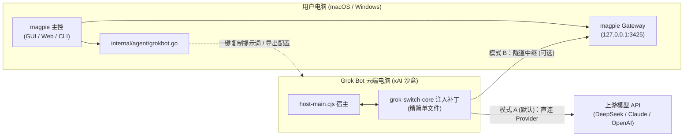
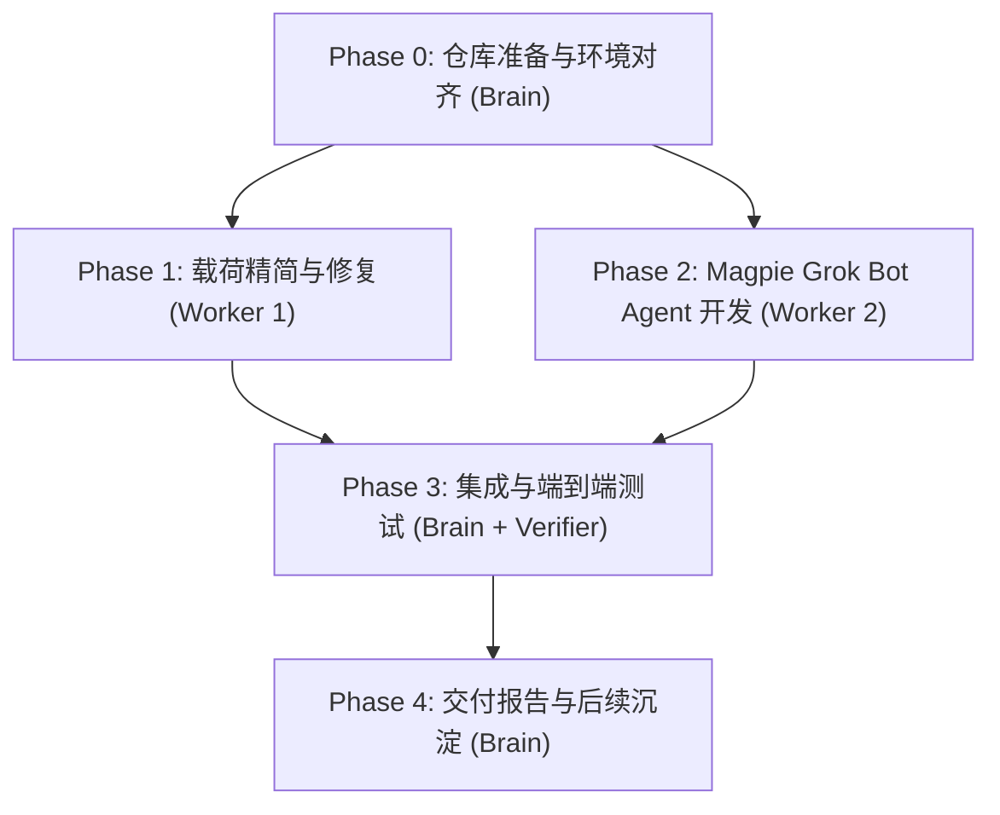

# 交付计划：基于 yetone/magpie 二开集成 Grok Bot 云端沙盒切换

## 1. 对齐快照 (Alignment Snapshot)

- **Audience & Outcome**: 为 Ender 及使用 magpie 与 Grok Bot 的个人开发者提供统一模型路由体验。通过二开 `yetone/magpie` 引入 `Grok Bot` Agent 模块，直接复用 magpie 的全协议网关、Provider 预设、多模型切换与 macOS/Windows 原生客户端；同时将 `grok-bot-switch` 提炼为高内聚、轻量化的云端注入探针（去除冗余 Web 面板与重复协议层）。
- **Building (建设范围)**:
  1. 将 `https://github.com/yetone/magpie` clone 到 `/Volumes/ExternalWork/magpie`，建立本地二开工程。
  2. 精简 `grok-bot-switch`：修复 `machineId` 空值误杀（自动 omit 回退云端执行）、移除 `createCursorSandInference` 强依赖（防升级拒装），剔除独立的 React 前端与旧 UI 服务，提炼成极简的云端注入载荷 `grok-switch-core.cjs`。
  3. 在 magpie 中实现 `internal/agent/grokbot.go`：将 Grok Bot 注册为一级 Agent，支持选择 Provider 模型，支持“模式 A：直连 Provider”与“模式 B：通过本地网关中继”两种工作模式。
  4. 为 magpie 添加 Grok Bot 专属的提示词生成与连接向导（`AgyLaunch` 风格的自动化 shell 命令与会话提示词）。
  5. 编写单元测试 `internal/agent/grokbot_test.go`，确保模型切换、参数构造与提示词生成正确无误。
- **Not Building (非目标/明确排除)**:
  - 不入侵 Grok Bot 官方服务端（保持现有云端沙盒客户端打补丁机制）；
  - 不篡改 magpie 已有的 45+ 本地 Agent 逻辑与既有测试；
  - 不引入闭源或需要付费账号的破坏性生产操作。
- **Source of Truth**:
  - `yetone/magpie` 官方最新仓库架构（Go 1.23+，`internal/agent` 体系，`internal/catalog`，`internal/gateway`）。
  - `grok-bot-switch` 经受真实云端验证的 `createHostInference` 挂载点与工具流式安全清洗逻辑。

---

## 2. 需求与产品设计 (PRD)

### 2.1 问题背景
- `grok-bot-switch` 之前单独维护 React 面板、本地存储、三套协议适配和 CLI，存在重复造轮子的问题，且面板必须在卡顿的 Grok Bot 云桌面内打开，体验割裂。
- `yetone/magpie` 拥有卓越的统一模型管理体验（macOS 菜单栏 / Web UI / 4 大协议网关 / 路由组），但其内置的 `grok` 仅针对本地 CLI（`Grok Build`，`~/.grok/config.toml`），无法支持运行在 xAI 云端沙盒电脑里的 `Grok Bot`。

### 2.2 用户故事 (User Stories)
1. **统一选模型**：用户在本地打开 magpie（菜单栏或 Web UI），在 Agents 列表中点击 `Grok Bot`，直接从 magpie 的统一模型列表中挑选想要使用的模型（如 DeepSeek-V3、Claude 3.7、GPT-4o、Kimi）。
2. **一键生成提示词**：magpie 界面展示并允许一键复制 Grok Bot 专属的云端安装/同步提示词。
3. **零学习成本生效**：用户把提示词粘贴给 Grok Bot，Grok Bot 自动下载核心探针、打上热补丁并瞬间切换至所选模型。
4. **聊天框极速切回**：在 Grok Bot 聊天框发 `/gs official` 瞬间切回官方模型，发 `/gs use <name>` 或新的 magpie 指令无缝切换。

### 2.3 成功标准 (Success Criteria)
- `yetone/magpie` 编译通过，全量现有 Agent 测试无回归。
- `grokbot.go` 完整实现 `Agent` 结构体契约，覆盖模型选项列表、默认模型设置、提示词生成器。
- 精简版 `grok-switch-core.cjs` 经语法校验与模拟宿主测试，具备空 `machineId` 过滤与防死循环保护。

---

## 3. 技术规格与架构设计 (SPEC)

### 3.1 架构拓扑

### 3.2 关键数据契约与接口
1. **Agent 标识**：
   - `ID: "grok-bot"`
   - `Name: "Grok Bot"`
   - `Icon: "grok"`
   - `Dir: "/workspace/grok-switch"`
2. **模式 A（直连 Provider，默认推荐）**：
   - magpie 根据当前选中的模型，提取其 Provider 的 `BaseURL`, `APIKey`, `Protocol`, `ModelID`。
   - 生成一段标准的 Grok Bot 执行指令，使沙盒直连目标服务，无需本地公网 IP 或穿透隧道。
3. **模式 B（网关模式，进阶选项）**：
   - 配置目标为 `gateway.URL()`（通过 Tailscale 或 Cloudflare 隧道暴露的公网端点），享受 magpie 的智能 Failover、账号轮换池与订阅中继。

### 3.3 云端载荷精简 (grok-switch-core)
- 移除：`panel/`（React 界面）、`src/ui.cjs`（UI HTTP 服务）。
- 保留并修复：
  - `src/runtime.cjs`：补丁包裹、路由解析、聊天框 `/gs` 指令拦截。
  - `src/protocols/tools.cjs`：强化参数清洗，对 `machineId: ""` 或 `null` 执行安全 omit。
  - `src/cli.cjs`：移除对 `createCursorSandInference` 强绑，只认 `createHostInference`。

---

## 4. 验收矩阵 (Acceptance Matrix)

| 准则 (Criterion) | 证据级别 | 测试/验证方式 | 状态 | 说明 |
|---|---|---|---|---|
| magpie 仓库拉取与编译成功 | local | `cd /Volumes/ExternalWork/magpie && go build ./...` | pending | 确保基础 Go 代码在当前机器上能干净构建 |
| grok-switch 核心载荷修复与精简 | local | `node --check dist/grok-switch-core.cjs && npm test` | pending | 修复 machineId 空值处理与锚点宽松检查 |
| grokbot.go 实现与单元测试通过 | local | `go test ./internal/agent -v -run TestGrokBot` | pending | 测试 Agent 注册、选项读取、提示词生成 |
| magpie Agent 列表包含 Grok Bot | local | `go run . agents` 或 CLI 查询包含 `grok-bot` | pending | 确认命令行与 GUI 均可感知该 Agent |
| 现有 Agent 零回归 | local | `go test ./internal/agent/...` 跑通已有主要测试 | pending | 保证既有 45+ agent 无破坏 |

---

## 5. 分阶段实施与并行任务规划 (Phase Plan)

### 切片定义与职责分工：
- **Slice 0 (Brain 主持)**：在 `/Users/sunny/Work/CODEX/magpie` clone `yetone/magpie` 仓库，验证编译基线。
- **Slice 1 (Worker 1: Payload Refiner)**：在 `grok-bot-switch` 工作区修复 `machineId` 与锚点问题，剔除 UI 代码，产出超轻量 `dist/grok-switch-core.cjs`。
- **Slice 2 (Worker 2: Magpie Agent Builder)**：在 `magpie` 仓库实现 `internal/agent/grokbot.go` 与 `internal/agent/grokbot_test.go`。
- **Slice 3 (Brain & Verifier: Integration)**：集成测试，验证 magpie 生成的提示词与 `grok-switch-core` 的无缝协作。
